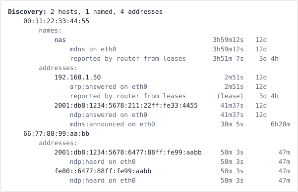

# ipv6disc: host discovery

[](https://github.com/miguelangel-nubla/ipv6disc/actions/workflows/ci.yaml)
[](https://github.com/miguelangel-nubla/ipv6disc/releases/latest)
[](https://pkg.go.dev/github.com/miguelangel-nubla/ipv6disc)

`ipv6disc` finds the hosts on the local network and their addresses, each with its MAC, over IPv6 and IPv4. It listens to the network, probes it, and reads routers' neighbor tables. The name dates from when it was IPv6 only.

It also learns the hosts' names, through each protocol that is turned on:

- names the hosts announce over mDNS, or give when they ask for an address by DHCP;
- names the hosts answer with when asked, by mDNS, NetBIOS, LLMNR, WS-Discovery or SSDP;
- names a DNS server has for their addresses;
- names in the routers' DHCP leases.

It is both a command and a Go library. [ipv6ddns](https://github.com/miguelangel-nubla/ipv6ddns) uses the library to keep DNS records for the devices on a network.

## Installation

- **A release**: download the binary for your system from the [latest release](https://github.com/miguelangel-nubla/ipv6disc/releases/latest).
- **With [Homebrew](https://brew.sh)**, on macOS: `brew install miguelangel-nubla/tap/ipv6disc`. It is built from source, on your machine, with its manual page.
- **Docker**: `ghcr.io/miguelangel-nubla/ipv6disc`, for linux/386, amd64, arm/v6, arm/v7 and arm64.
- **From source**: `go install github.com/miguelangel-nubla/ipv6disc/cmd/ipv6disc@latest`.

## Usage

This shows the hosts in the terminal as they are found:

```
sudo ipv6disc --live
```

Without `--live`, it logs them as JSON, which you can filter with [`jq`](https://jqlang.github.io/jq/):

```
sudo ipv6disc | jq 'select(.msg == "host identified") | .ip'
```

Everything else is set in a YAML configuration file: the families, each protocol with its switch and its options, the names, the interfaces, the lifetimes, and the plugins. Without a file, the defaults discover IPv6, by every protocol, along with the names the hosts give.

This `discovery.yaml` adds IPv4, and a router's neighbor table:

```yaml
ipv4:
  enabled: true
plugins:
  router:
    type: mikrotik
    interval: 60s
    address: 192.168.88.1
    username: ipv6disc
    password: "secret"
```

Run it with Docker:

```
docker run -it --rm --network host -v "$PWD/discovery.yaml:/discovery.yaml:ro" \
  ghcr.io/miguelangel-nubla/ipv6disc --live --config /discovery.yaml
```

The [example configuration](cmd/ipv6disc/example.config.yaml) shows every key, and the [configuration reference](docs/reference/configuration.md) lists them. The command has three flags: `--config`, `--live` and `--version`.

### Privileges and Docker

IPv6 local discovery needs root or `CAP_NET_RAW`. In Docker it also needs the host's network: see [privileges](docs/discovery.md#privileges).

The Docker image contains only the binary:

- Mount the configuration file into the container, along with any file a plugin reads, such as an `identity_file`.
- The image has no CA certificates. So a mikrotik plugin with `use_tls: true` needs its [`tls_fingerprint`](docs/plugins.md#a-mikrotik-user) there.

### The log

The log has one event per change, each with the `ip`, `mac` and `source`:

- `host identified` when an address is found;
- `host expired` when an address goes;
- `host removed` when one of this machine's own addresses is no longer on its interface.

`log_level: debug` adds each refresh.

Two more events report a host's [names](docs/discovery.md#names) as they come and go, with the `name`, `mac` and `source`: `host named` and `host name expired`.

### The live view

`--live` shows the current state instead of the log.

<picture>
  <source media="(prefers-color-scheme: dark)" srcset="docs/images/page-dark.svg">
  
</picture>

The two times on each line are how long it has left before it expires, and how long it has been seen.

- It hides errors too, such as those of a plugin that can't reach its router. Run without `--live` to see why hosts are missing.
- It needs a terminal, which in Docker means `-it`.
- It uses the terminal's colors for names and details, and none when `NO_COLOR` is set.
- It ends with `q`, or when the process is told to stop.
- To select and copy text, run it in `screen`. Press `Ctrl+a` then `Esc` for copy mode, and `Esc` again to resume updating.

## Documentation

| | |
|---|---|
| [Discovery](docs/discovery.md) | How hosts are found: the families, each protocol, interfaces, lifetimes, solicitation, and names |
| [Plugins](docs/plugins.md) | Reading routers' neighbor tables, and the names in their DHCP leases |
| [The library](docs/library.md) | Using it from Go |
| [Configuration reference](docs/reference/configuration.md) | Every key of the configuration file, generated from its schema |
| [Flags reference](docs/reference/cli.md) | The three flags, generated from the code |
| [Plugins reference](docs/reference/plugins.md) | Every plugin's fields, generated from the code |

To contribute, see [CONTRIBUTING.md](CONTRIBUTING.md). To report a security issue, see [SECURITY.md](SECURITY.md).
